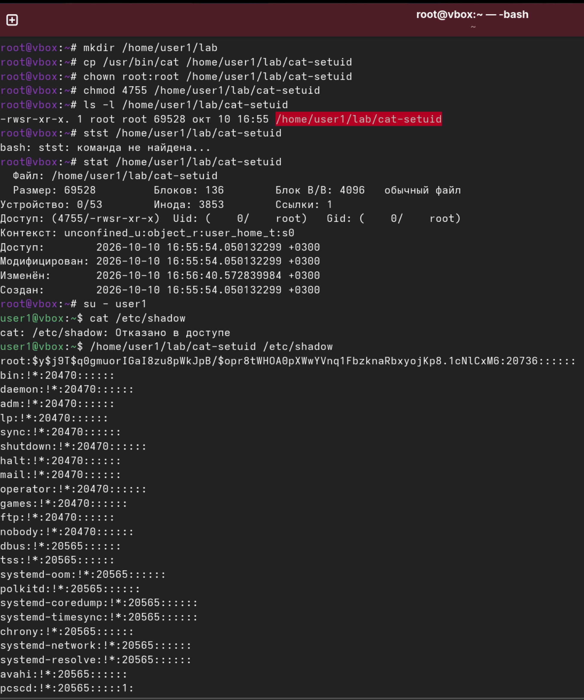
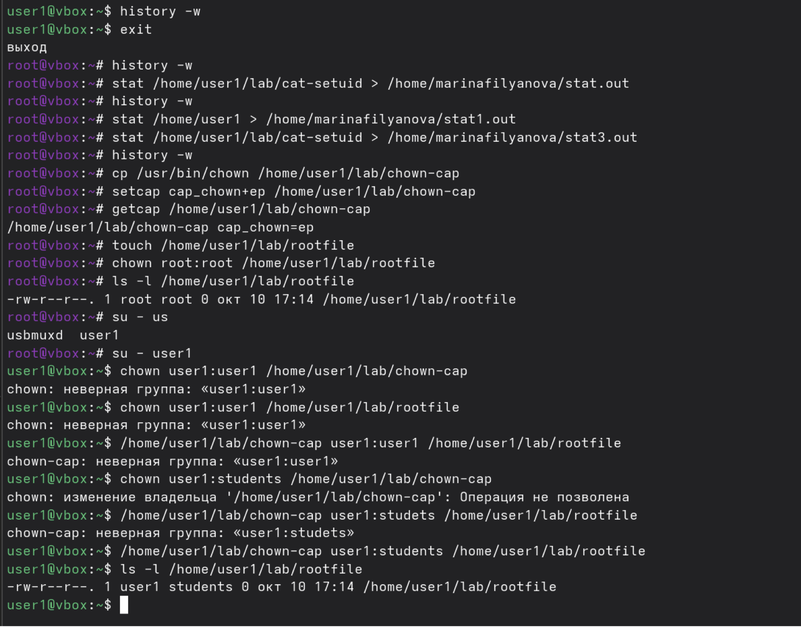
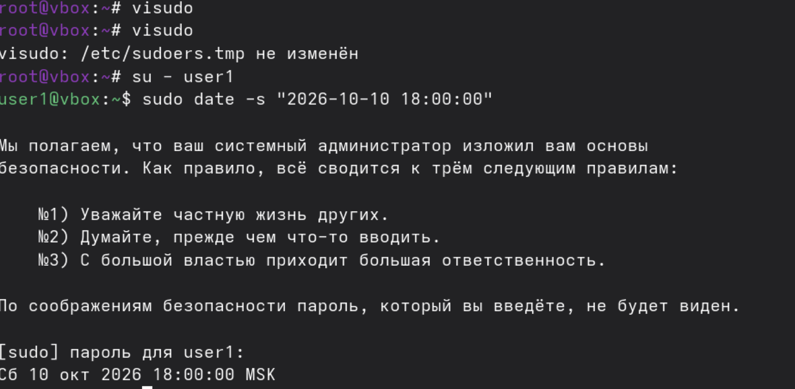

# ДЗ №1: Изучение средств защиты ОС GNU/Linux

**Студент:** *Филянова Марина Андреевна*  
**Уникальный номер (шифр):** *373040*  
**Операционная система:** *Fedora Linux (версия 44)*  

## Описание выполненных работ

Ниже приведено пошаговое описание выполнения каждого раздела задания с использованием стандартных POSIX-команд в терминале. Все команды выполнялись в терминале с повышением привилегий через `su -` для получения прав суперпользователя (root).

### Раздел 1. Создание пользователя

Пользователь `user1` был создан с использованием следующих команд (выполнялось под `su -`):

```bash
su -
# Создание новой группы 
groupadd students

# Создание нового пользователя
useradd -m -u 1234 -g students user1

# Создание пароля для нового пользователя
passwd user1

# Настройка обязательной смены пароля каждые 90 дней
chage -M 90 user1

# Вывод информации о настройках пароля пользователя
chage -l user1

# Сохранение артефактов
stat /home/user1 > /home/marinafilyanova/stat1.out
cp /etc/group /home/marinafilyanova/group
cp /etc/passwd /home/marinafilyanova/passwd
cp /etc/shadow /home/marinafilyanova/shadow
```
### Раздел 2. Мониторинг файлов и процессов
```bash
# Поиск всех файлов с битом set-UID
find / -xdev -type f -perm -4000 -ls 2>/dev/null | tee /home/marinafilyanova/setuid

# Поиск процессов с повышенными привилегиями
ps -eo ruid=,euid=,pid=,comm= | awk '$1 != 0 && $2 ==0' > /home/marinafilyanova/procuid
```

### Раздел 3. Изучение механизма set-UID
```bash
# Создание рабочей директории
mkdir /home/user1/lab

# Копирование утилиты
cp /usr/bin/cat /home/user1/lab/cat-setuid

# Установка владельца root и бита set-UID
chown root:root /home/user1/lab/cat-setuid 
chmod 4755 /home/user1/lab/cat-setuid

# Проверка прав доступа
ls -l /home/user1/lab/cat-setuid 
stat /home/user1/lab/cat-setuid

# Переключение на пользователя user1
su - user1

# Попытка прочитать защищённый файл /etc/shadow обычной командой cat
cat /etc/shadow

# Чтение файла /etc/shadow через модифицированную утилиту с битом set-UID
/home/user1/lab/cat-setuid /etc/shadow

# Сохранение артефактов
stat /home/user1/lab/cat-setuid > /home/marinafilyanova/stat.out
```
#### Подтверждение выполнения



### Раздел 4. Изучение механизма привилегий (Capabilities)
```bash
# Копирование утилиты
cp /usr/bin/chown /home/user1/lab/chown-cap

# Назначение мандата cap_chown
setcap cap_chown+ep /home/user1/lab/chown-cap

# Проверка мандата
getcap /home/user1/lab/chown-cap

# Создание тестового файла 
touch /home/user1/lab/rootfile

# Смена владельца тестового файла на root
chown root:root /home/user1/lab/rootfile

# Переключение на пользователя user1
su - user1

# Попытка смены владельца утилиты chown-cap на user1
chown user1:students /home/user1/lab/chown-cap

# Запуск утилиты chown-cap для смены владельца
/home/user1/lab/chown-cap user1:students /home/user1/lab/rootfile

# Проверка владельца файла rootfile
ls -l /home/user1/lab/rootfile

# Сохранение артефактов
stat /home/user1/lab/chown-cap > /home/marinafilyanova/stat4.out
getcap /home/user1/lab/chown-cap > /home/marinafilyanova/getcap.out
```

### Раздел 5. Изучение механизма sudo
```bash
# Открытие файла /etc/sudoers
visudo 

# Переключение на пользователя user1
su - user1

# Изменение системного времени через sudo
sudo date -s "2026-10-10 18:00:00"

# Сохранение артефактов
cp /etc/sudoers /home/marinafilyanova/sudoers
```

## Описание артефактов (файлов в репозитории)

| Файл | Раздел | Что проверяется / Содержимое |
|------|--------|------------------------------|
| `mephi-screenshot.png` | 6 | Скриншот терминала с видимым уникальным номером студента. |
| `history.out` | Все | История выполненных команд в терминале. |
| `stat.out` | 1, 3, 4 | Вывод команды `stat` для `/home/user1`, `/home/user1/lab/cat-setuid` и `~/home/user1/lab/chown-cap` (подтверждение прав доступа и владельцев). |
| `getcap.out` | 4 | Вывод команды `getcap` для `~/home/user1/lab/chown-cap` (подтверждение наличия мандата `cap_chown`. |
| `setuid` | 2 | Список файлов с битом set-UID в системе. |
| `procuid` | 2 | Вывод мониторинга процессов с повышенными привилегиями. |
| `passwd` | 1 | Фрагмент `/etc/passwd` с записью о `user1`. |
| `shadow` | 1 | Фрагмент `/etc/shadow` с записью о `user1` (пароль хэширован). |
| `group` | 1 | Фрагмент `/etc/group` с записью о группе `students`. |
| `sudoers` | 5 | Содержимое файла `/etc/sudoers`. |
